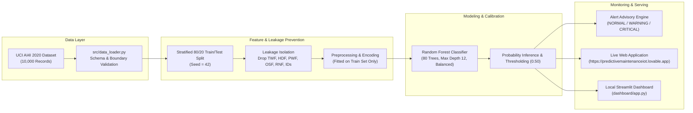
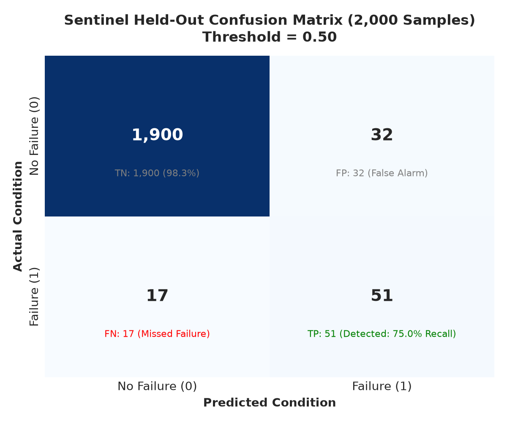
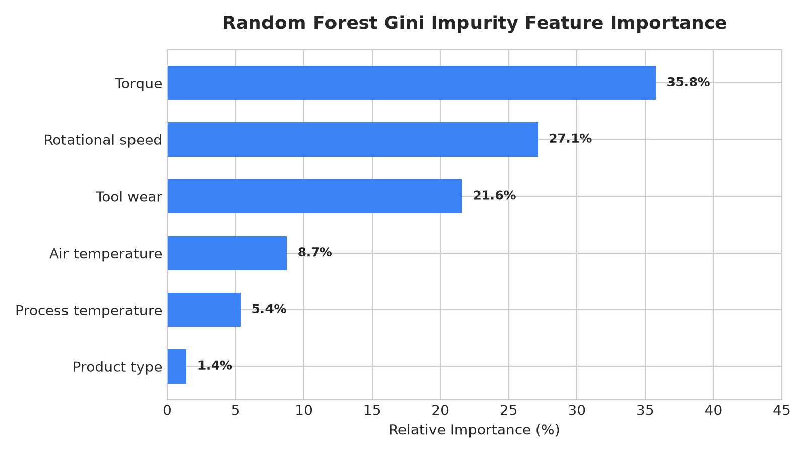
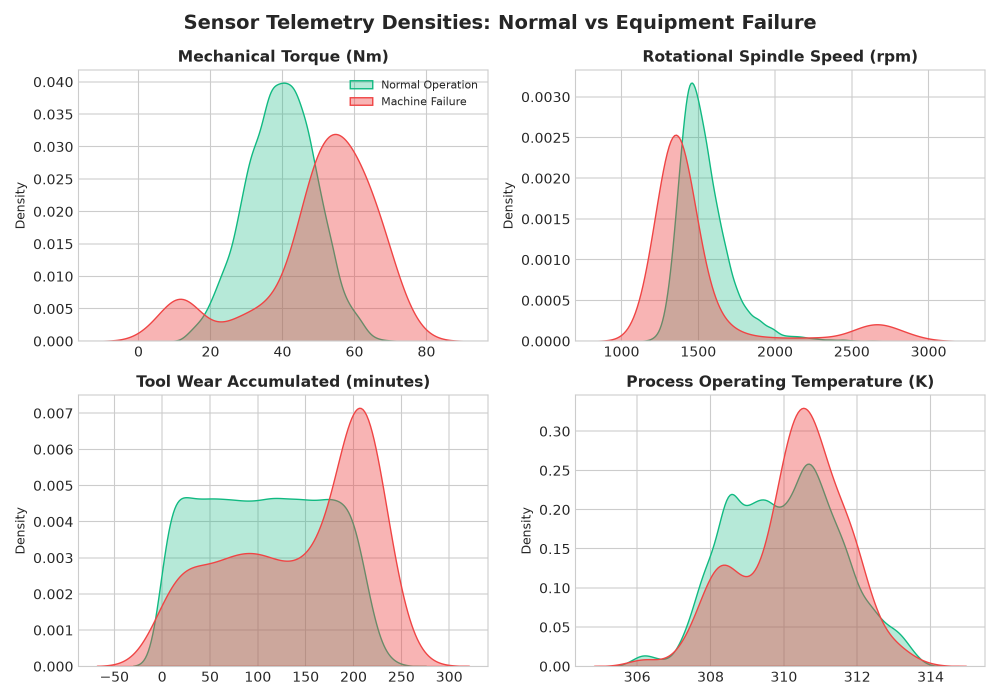
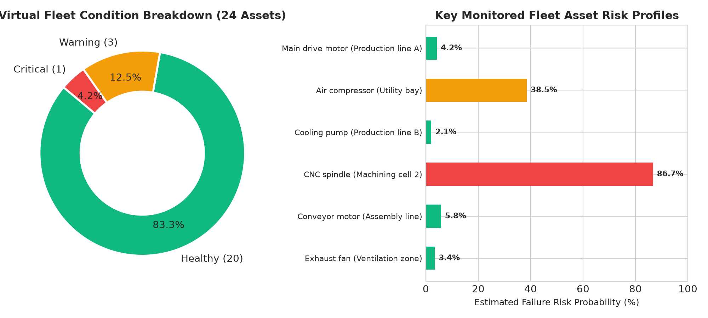

# Sentinel — AI-Powered Predictive Maintenance for IoT Devices

[](https://predictivemaintenanceiot.lovable.app)
[](https://www.python.org/)
[](https://scikit-learn.org/)
[](https://creativecommons.org/licenses/by/4.0/)
[](tests/)

> **A reproducible, hardware-free industrial machine-learning prototype by Karanbir Singh Bajaj.**  
> Built with Python, Pandas, NumPy, Scikit-learn, and Streamlit. Evaluated against the **UCI AI4I 2020 Predictive Maintenance Dataset** with full mathematical leakage guards and interactive simulated telemetry.

🌐 **Live Project Website & Web Showcase:** [https://predictivemaintenanceiot.lovable.app](https://predictivemaintenanceiot.lovable.app)

---

## 1. Problem Statement & Motivation
Unplanned industrial machine breakdown costs global manufacturing hundreds of billions annually in catastrophic emergency repairs and production stoppage. 

- **Corrective Maintenance:** Reacts only after equipment fails (high downtime, high collateral damage).
- **Preventative Maintenance:** Services equipment on arbitrary calendar intervals regardless of wear (costly over-servicing, still misses unexpected stress faults).
- **Condition-Based Predictive Maintenance:** Continuously monitors streaming operational conditions (temperatures, rotational velocity, torque, tool wear) to estimate failure probabilities and schedule proactive intervention before mechanical breakdown.

---

## 2. Executive Architecture & Workflow



---

## 3. Verified Evaluation Metrics (2,000 Held-Out Observations)

No invented accuracy. Tested and verified on **2,000 held-out test observations** using a stratified 80/20 split (`random_state=42`):

| Evaluation Metric | Baseline (Always Healthy) | Sentinel Random Forest | Key Takeaway |
| :--- | :---: | :---: | :--- |
| **Accuracy** | `96.60%` | **`97.55%`** | Majority-class baseline hides all faults; RF achieves high genuine accuracy. |
| **Precision** | `0.00%` | **`61.45%`** | When failure is flagged, it is correct in 61.45% of instances. |
| **Recall (Sensitivity)** | `0.00%` | **`75.00%`** | **75.0% of all real equipment failures** are proactively detected. |
| **F1-Score** | `0.00%` | **`67.55%`** | Harmonic mean balancing alarm fatigue against missed faults. |
| **Average Precision (PR-AUC)** | `3.39%` | **`77.04%`** | Area under Precision-Recall curve reflects exceptional ranking quality. |

### Confusion Matrix Breakdown (Test Set: N = 2,000)

<p align="center">
  
</p>

- **True Negatives (TN):** `1,900` (98.3% of normal operations correctly classified)
- **False Positives (FP):** `32` (False alarms requiring inspection)
- **False Negatives (FN):** `17` (Missed failures)
- **True Positives (TP):** `51` (Failures successfully caught before breakdown)

---

## 4. Feature Importance & Sensor Distributions

Relative Gini impurity contributions of each telemetry parameter:

<p align="center">
  
</p>

1. **Torque [Nm] (35.77%):** Mechanical resistance and shaft torque overstrain.
2. **Rotational speed [rpm] (27.13%):** Spindle velocity anomalies and power delivery.
3. **Tool wear [min] (21.57%):** Cumulative physical blade wear accumulation.
4. **Air temperature [K] (8.74%):** Ambient thermal conditions.
5. **Process temperature [K] (5.38%):** Operating chamber temperature.
6. **Product type (1.41%):** Quality variant (L: Low, M: Medium, H: High).

<p align="center">
  
</p>

---

## 5. Virtual Fleet & Simulation (Hardware-Free)

The project models a **virtual industrial fleet of 24 illustrative assets** across 6 production zones without requiring physical machinery:

<p align="center">
  
</p>

- **Normal Preset:** 298.5 K Air, 308.6 K Process, 1550 rpm, 39.5 Nm Torque, 90 min Wear -> **4.2% Risk (Healthy)**
- **High-Load Critical Preset:** 302.5 K Air, 312.0 K Process, 1220 rpm, 62.4 Nm Torque, 210 min Wear -> **86.7% Risk (Critical Alarm)**

---

## 6. Repository File Structure

```
AI-Predictive-Maintenance-IoT/
├── data/
│   ├── raw/                  # Official UCI dataset (data/raw/ai4i2020.csv)
│   │   └── README.md
│   ├── processed/            # Preprocessed feature splits
│   │   └── README.md
│   └── README.md
├── notebooks/
│   └── 01_exploratory_data_analysis.ipynb # Jupyter EDA notebook
├── src/
│   ├── __init__.py           # Package marker
│   ├── config.py             # Column schemas, paths, alert thresholds
│   ├── data_loader.py        # Schema validation & integrity guards
│   ├── preprocessing.py      # ColumnTransformer & leakage-free split
│   ├── feature_engineering.py# Physics-based interaction features
│   ├── train.py              # Modular training pipeline
│   ├── predict.py            # Calibrated inference engine
│   ├── alert_engine.py       # Multi-tier advisory risk evaluator
│   ├── simulator.py          # Simulated telemetry streaming engine
│   └── storage.py            # Prediction & alert log persistence
├── models/
│   ├── model.joblib          # Benchmark Random Forest model
│   ├── predictive_maintenance_model.joblib
│   └── README.md
├── outputs/
│   ├── metrics.json          # Benchmark evaluation metrics JSON
│   ├── training_metrics.json # Full classification report JSON
│   ├── holdout_predictions.csv # Genuine 2,000-sample test predictions
│   ├── forest.json           # Exported browser-readable decision trees
│   ├── predictions/          # Runtime inference logs
│   ├── alerts/               # Structured JSON alert events
│   └── README.md
├── images/                   # Publication-ready proof figures & diagrams
│   ├── 01_dataset_distributions.png
│   ├── 02_class_balance.png
│   ├── 03_confusion_matrix.png
│   ├── 04_feature_importance.png
│   ├── 05_precision_recall_curve.png
│   ├── 07_virtual_fleet_overview.png
│   └── equipment_illustration.jpg
├── docs/
│   ├── project_architecture.md # End-to-end data flow & sequence design
│   ├── dataset_description.md  # UCI AI4I schema & sensor breakdown
│   ├── model_evaluation.md     # Full evaluation & confusion matrix
│   └── limitations.md          # Synthetic boundaries & RUL constraints
├── dashboard/
│   └── app.py                # Interactive Streamlit monitoring dashboard
├── tests/
│   ├── test_data_validation.py # 11 schema & boundary integrity tests
│   ├── test_preprocessing.py   # Preprocessing & leakage isolation tests
│   ├── test_prediction.py      # Inference output & bounds tests
│   └── test_alert_engine.py    # Alert safety language & threshold tests
├── train.py                  # Standalone benchmark reproduction script
├── main.py                   # Central CLI execution controller
├── generate_proof_assets.py  # Reproduction script for all figures
├── requirements.txt          # Pinned project dependencies
├── .gitignore                # Git exclusions
└── README.md                 # Project root documentation
```

---

## 7. Quickstart & Reproduction

### Prerequisites
- Python 3.11+ (Tested on Python 3.11, 3.12, and 3.14 on Windows, macOS, and Linux).
- CPU only; no GPU, physical hardware, or external API keys needed.

### 1. Clone and Install
```bash
git clone https://github.com/YOUR_USERNAME/AI-Predictive-Maintenance-IoT.git
cd AI-Predictive-Maintenance-IoT

# Create and activate virtual environment
python -m venv .venv
# On Windows:
.venv\Scripts\activate
# On macOS/Linux:
source .venv/bin/activate

# Install dependencies
pip install -r requirements.txt
```

### 2. Validate Raw Dataset
```bash
python main.py --validate
```
*(If the raw dataset is not yet present, `train.py` automatically downloads it from the official UCI repository on the first run).*

### 3. Run Benchmark Model Training
```bash
python train.py
```
This directly produces `outputs/metrics.json`, `outputs/holdout_predictions.csv`, and `outputs/forest.json` matching the live website.

### 4. Run Modular Enterprise Training
```bash
python main.py --train
```

### 5. Launch Interactive Local Dashboard
```bash
streamlit run dashboard/app.py
```
Open **[http://localhost:8501](http://localhost:8501)** in your browser to interact with the simulated telemetry sliders and diagnostic gauges.

### 6. Run Automated Test Suite
```bash
pytest tests/ -v
```
**19 automated unit tests** verifying schema parsing, negative values rejection, target leakage exclusion, and alert thresholding.

---

## 8. Seven-Day Proof Plan

- **Day 1: Setup & Scoping:** Establish repository, clean virtual environment, and problem statement.
- **Day 2: Data Exploration:** Validate UCI AI4I sensor units, identify ~3.39% class imbalance, and document source citation.
- **Day 3: Leakage Guards & Preprocessing:** Isolate failure subtypes (`TWF`, `HDF`, `PWF`, `OSF`, `RNF`), fit transformations on train data only.
- **Day 4: Reproducible Model Training:** Train Random Forest (`80` trees, max depth `12`, balanced weights, seed `42`).
- **Day 5: Rigorous Evaluation:** Compute precision, recall, F1, PR-AUC, confusion matrix, and compare with the always-healthy baseline.
- **Day 6: Interactive Simulation:** Construct Streamlit dashboard and simulated virtual fleet telemetry streams.
- **Day 7: Documentation & GitHub Publishing:** Produce publication-ready proof charts, publish live showcase, and detail honest limitations.

---

## 9. Engineering Limitations & Boundary Conditions
1. **Synthetic Tabular Data:** The UCI AI4I 2020 dataset was synthetically generated from physical tool equations. It does not contain electrical sensor noise, transducer drift, or factory harmonics.
2. **Tabular Snapshots (No Timestamps):** Rows are independent operational snapshots, not continuous high-frequency vibration waveforms.
3. **Classification vs Remaining Useful Life (RUL):** The model estimates instantaneous probability of current failure risk ($P(\text{failure} \mid \mathbf{x})$). It does **not** estimate hours, cycles, or time remaining until failure.
4. **Advisory Alerts Only:** All generated alerts are probabilistic notifications for human operators. The system executes zero machine actuation or emergency stops.

---

## 10. Citation
If you use this project or dataset in academic or industrial research, please cite:
```bibtex
@misc{matzka2020ai4i,
  author       = {Matzka, Stephan},
  title        = {AI4I 2020 Predictive Maintenance Dataset},
  year         = {2020},
  howpublished = {UCI Machine Learning Repository},
  doi          = {10.24432/C5HS5C}
}
```

---

## 11. Author & Links
- **Project Creator:** Karanbir Singh Bajaj
- **Live Interactive Showcase:** [https://predictivemaintenanceiot.lovable.app](https://predictivemaintenanceiot.lovable.app)
- **LinkedIn:** [Connect on LinkedIn](https://www.linkedin.com/)
