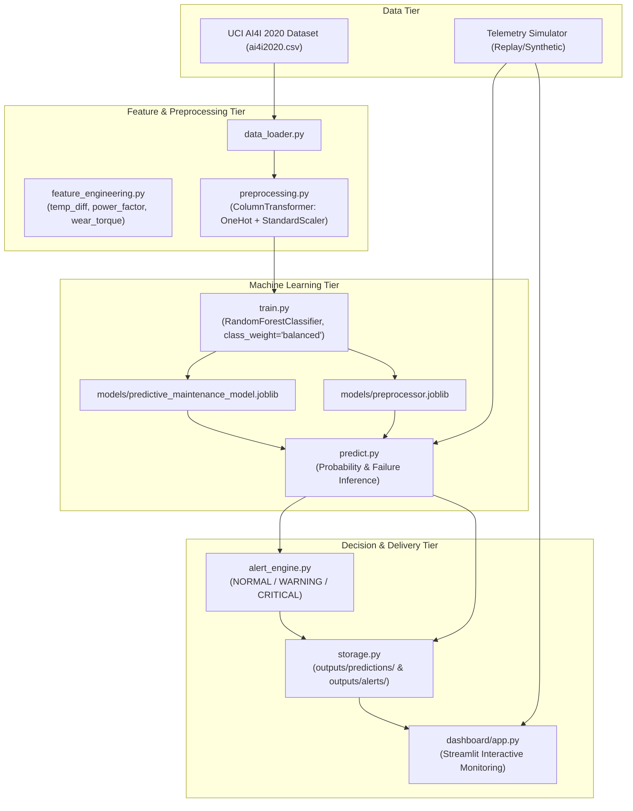

# Project Architecture

## 1. System Overview
The **AI-Predictive-Maintenance-IoT** project is an educational machine learning and simulated IoT system designed to forecast equipment failure risks before breakdown occurs.

## 2. Component Pipeline Description

### A. Data Ingestion (`data_loader.py`)
- Reads the tabular telemetry dataset or falls back to synthetic telemetry generation for offline testing.
- Preserves raw columns without mutation.

### B. Feature Engineering (`feature_engineering.py`)
- Derives physical interactions from raw sensor telemetry:
  - `temp_diff`: Thermal dissipation proxy (\(T_{process} - T_{air}\)).
  - `power_factor`: Mechanical power proxy (\(\text{Speed} \times \text{Torque}\)).
  - `tool_wear_torque`: Mechanical load under tool degradation.
- **Safety guarantee:** Explicitly drops ID fields and target failure columns to prevent target leakage.

### C. Preprocessing (`preprocessing.py`)
- Standardizes numerical variables and one-hot encodes categorical machine types (`Type`: L, M, H).
- **Leakage protection:** Preprocessor is fitted **strictly** on the training partition after stratified splitting.

### D. Model Training (`train.py`)
- Employs a scikit-learn `RandomForestClassifier` with balanced class weights to address the severe ~3.4% failure class imbalance.
- Serializes model and preprocessing objects to `models/`.

### E. Inference & Advisory Engine (`predict.py` & `alert_engine.py`)
- Ingestion of live or simulated sensor telemetry records.
- Transforms features using the saved transformer and generates calibrated failure probabilities.
- `alert_engine.py` categorizes operational state into `NORMAL`, `WARNING`, or `CRITICAL`. Messages remain strictly advisory.

### F. Persistence & Presentation (`storage.py` & `dashboard/app.py`)
- Persists inference records to `outputs/predictions/` and alert events to `outputs/alerts/`.
- Streamlit application displays real-time telemetry metrics, risk gauges, and historical alert distributions.
